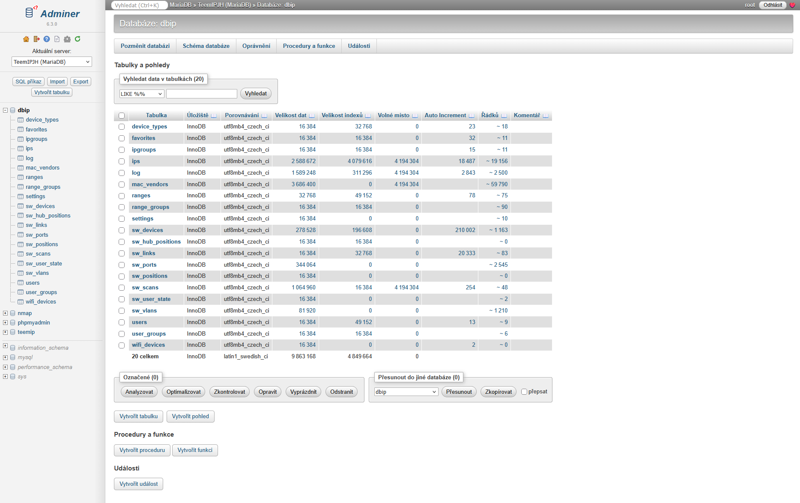

# Adminer phpMyAdmin Style

**English** | [Česky](#čeština)

A set of plugins and a stylesheet that give [Adminer](https://www.adminer.org/) a look and navigation inspired by phpMyAdmin (similar to its *pmahomme* theme): a database tree in the left panel, a row of quick-access icons, a server switcher and similar colours. It is an independent stylesheet, not a copy of phpMyAdmin.



## Adminer version

| | |
|---|---|
| Included Adminer version | **6.3.0** |
| Tested with | Adminer **6.3.0**, MariaDB and MS SQL |

The bundled `adminer.php` is the **original, unmodified** Adminer 6.3.0 from [adminer.org](https://www.adminer.org/). All changes are made only through plugins and `adminer.css`, so you can update Adminer by replacing `adminer.php` with a newer version. A newer version has not been tested and the stylesheet may need small adjustments.

## Repository structure

```
adminer/
├── adminer.php              original Adminer 6.3.0 (unmodified)
├── adminer.css              phpMyAdmin-like theme (light mode only)
├── adminer-plugins.php      plugin configuration (EXAMPLE server list)
└── adminer-plugins/         plugins (loaded automatically)
docs/
└── screenshot.png
LICENSE                      Apache License 2.0
LICENSE-GPL-2.0              GNU GPL 2
README.md
```

## Plugins

| Plugin | File | Description |
|---|---|---|
| `AdminerLoginServers` | `login-servers.php` | Shows a fixed list of servers in the login form instead of a free-text field. **Modified version of the original Adminer plugin [login-servers](https://github.com/vrana/adminer/blob/master/plugins/login-servers.php)** by Jakub Vrána. |
| `AdminerServerSelect` | `server-select.php` | "Current server" drop-down in the left panel, similar to phpMyAdmin. Takes the server list from `AdminerLoginServers`. Switches directly to servers you are already logged in to, otherwise opens the login form with the server preselected. |
| `AdminerDatabaseTree` | `database-tree.php` | Left panel similar to phpMyAdmin: a tree of all databases on the server, with the tables of the current database shown below it. Databases can be expanded/collapsed, system databases are listed last. |
| `AdminerNavIcons` | `nav-icons.php` | Row of icons under the logo: Home, Log out, Adminer help, SQL documentation (by server type – MySQL, MariaDB, MS SQL, PostgreSQL, SQLite, Oracle), Server variables and Reload. |
| `AdminerLogoHome` | `logo-home.php` | The logo links to the home page of this Adminer (current server, or the login page) instead of adminer.org. |
| `AdminerBreadcrumbConfirm` | `breadcrumb-confirm.php` | The first link in the top breadcrumb (server type, e.g. "MariaDB") logs you out after confirmation, like the Log out button. |

> The user interface texts of the plugins are in Czech.

## Installation

1. Copy the contents of the `adminer/` directory to your web server (PHP with the extensions for your databases, e.g. `mysqli` / `pdo_mysql`, `sqlsrv`).
2. Edit `adminer-plugins.php` and fill in your own servers. **The server list in this file is only an example** (`server1.example.com`, `server2.example.com`, …) and must be replaced with your servers:

   ```php
   <?php
   return array(
       new AdminerLoginServers(array(
           'Server1 (MariaDB)' => array('server' => 'server1.example.com', 'driver' => 'server'), // 'server' = MySQL/MariaDB
           'Server4 (MS SQL)'  => array('server' => 'server4.example.com', 'driver' => 'mssql'),
       )),
       new AdminerBreadcrumbConfirm(),
   );
   ```

3. Open `adminer.php` in your browser. Plugins in `adminer-plugins/` and `adminer.css` are loaded by Adminer automatically.

### Updating Adminer

Download a new version from [adminer.org](https://www.adminer.org/#download) and replace `adminer/adminer.php`. Nothing else needs to change.

## License

- **Adminer** © Jakub Vrána, licensed under [Apache License 2.0](https://www.apache.org/licenses/LICENSE-2.0) or [GNU GPL 2](https://www.gnu.org/licenses/gpl-2.0.html) (one or the other) – see [adminer.org](https://www.adminer.org/) and the [Adminer repository](https://github.com/vrana/adminer).
- **login-servers** plugin – original by Jakub Vrána (same licence as Adminer), used and modified in this project (the change is noted in the file header).
- The other plugins and the stylesheet are released under the same licences as Adminer (Apache 2.0 or GPL 2).
- Licence texts: [LICENSE](LICENSE) (Apache License 2.0) and [LICENSE-GPL-2.0](LICENSE-GPL-2.0) (GNU GPL 2). You may use the project under either of them.

## Disclaimer

This project is provided **"as is", without warranty of any kind**. Use at your own risk. It is not affiliated with Adminer or phpMyAdmin.

---

<a id="čeština"></a>

# Adminer phpMyAdmin Style

[English](#adminer-phpmyadmin-style) | **Česky**

Sada pluginů a stylů, které dávají [Admineru](https://www.adminer.org/) vzhled a navigaci inspirované phpMyAdminem (podobné jeho motivu *pmahomme*): strom databází v levém panelu, řadu ikon pro rychlý přístup, přepínač serverů a podobné barvy. Jde o samostatně vytvořené styly, nikoli o kopii phpMyAdminu.


## Verze Admineru

| | |
|---|---|
| Přiložená verze Admineru | **6.3.0** |
| Testováno na | Adminer **6.3.0**, MariaDB a MS SQL |

Přiložený `adminer.php` je **originální, neupravený** Adminer 6.3.0 z [adminer.org](https://www.adminer.org/). Všechny změny jsou řešeny pouze pluginy a souborem `adminer.css`, takže Adminer lze aktualizovat prostou výměnou `adminer.php` za novější verzi. Novější verze nebyly testovány a styly mohou vyžadovat drobné úpravy.

## Struktura repozitáře

```
adminer/
├── adminer.php              originální Adminer 6.3.0 (neupravený)
├── adminer.css              vzhled jako phpMyAdmin (pouze světlý režim)
├── adminer-plugins.php      konfigurace pluginů (UKÁZKOVÝ seznam serverů)
└── adminer-plugins/         pluginy (načítají se automaticky)
docs/
└── screenshot.png
LICENSE                      Apache License 2.0
LICENSE-GPL-2.0              GNU GPL 2
README.md
```

## Pluginy

| Plugin | Soubor | Popis |
|---|---|---|
| `AdminerLoginServers` | `login-servers.php` | V přihlašovacím formuláři zobrazí pevný seznam serverů místo textového pole. **Upravená verze originálního pluginu Admineru [login-servers](https://github.com/vrana/adminer/blob/master/plugins/login-servers.php)** od Jakuba Vrány. |
| `AdminerServerSelect` | `server-select.php` | Výběr „Aktuální server“ v levém panelu, podobně jako v phpMyAdminu. Seznam serverů bere z pluginu `AdminerLoginServers`. Na server, kde už jste přihlášeni, přepne rovnou, jinak otevře přihlášení s předvybraným serverem. |
| `AdminerDatabaseTree` | `database-tree.php` | Levý panel podobný phpMyAdminu: strom všech databází na serveru, pod aktuální databází se zobrazí její tabulky. Databáze lze rozbalit/sbalit, systémové databáze jsou na konci. |
| `AdminerNavIcons` | `nav-icons.php` | Řada ikon pod logem: Domů, Odhlásit, Nápověda k Admineru, Dokumentace SQL (podle typu serveru – MySQL, MariaDB, MS SQL, PostgreSQL, SQLite, Oracle), Proměnné serveru a Aktualizovat. |
| `AdminerLogoHome` | `logo-home.php` | Logo vede na úvodní stránku tohoto Admineru (aktuální server, případně přihlášení) místo na adminer.org. |
| `AdminerBreadcrumbConfirm` | `breadcrumb-confirm.php` | První odkaz v horní navigaci (typ serveru, např. „MariaDB“) po potvrzení odhlásí – stejně jako tlačítko Odhlásit. |

> Texty v uživatelském rozhraní pluginů jsou česky.

## Instalace

1. Zkopírujte obsah adresáře `adminer/` na webový server (PHP s rozšířeními pro vaše databáze, např. `mysqli` / `pdo_mysql`, `sqlsrv`).
2. Upravte `adminer-plugins.php` a doplňte vlastní servery. **Seznam serverů v tomto souboru je pouze ukázka** (`server1.example.com`, `server2.example.com`, …) a je potřeba ho nahradit vlastními servery:

   ```php
   <?php
   return array(
       new AdminerLoginServers(array(
           'Server1 (MariaDB)' => array('server' => 'server1.example.com', 'driver' => 'server'), // 'server' = MySQL/MariaDB
           'Server4 (MS SQL)'  => array('server' => 'server4.example.com', 'driver' => 'mssql'),
       )),
       new AdminerBreadcrumbConfirm(),
   );
   ```

3. Otevřete `adminer.php` v prohlížeči. Pluginy z `adminer-plugins/` i `adminer.css` načte Adminer automaticky.

### Aktualizace Admineru

Stáhněte novou verzi z [adminer.org](https://www.adminer.org/#download) a nahraďte jí soubor `adminer/adminer.php`. Nic dalšího měnit není potřeba.

## Licence

- **Adminer** © Jakub Vrána, licence [Apache License 2.0](https://www.apache.org/licenses/LICENSE-2.0) nebo [GNU GPL 2](https://www.gnu.org/licenses/gpl-2.0.html) (jedna nebo druhá) – viz [adminer.org](https://www.adminer.org/) a [repozitář Admineru](https://github.com/vrana/adminer).
- Plugin **login-servers** – originál od Jakuba Vrány (stejná licence jako Adminer), v tomto projektu použit a upraven (úprava je uvedena v hlavičce souboru).
- Ostatní pluginy a styly jsou vydány pod stejnými licencemi jako Adminer (Apache 2.0 nebo GPL 2).
- Texty licencí: [LICENSE](LICENSE) (Apache License 2.0) a [LICENSE-GPL-2.0](LICENSE-GPL-2.0) (GNU GPL 2). Projekt můžete používat podle kterékoli z nich.

## Bez záruky

Projekt je poskytován **„tak, jak je“, bez jakékoli záruky**. Používáte na vlastní riziko. Projekt nijak nesouvisí s autory Admineru ani phpMyAdminu.
